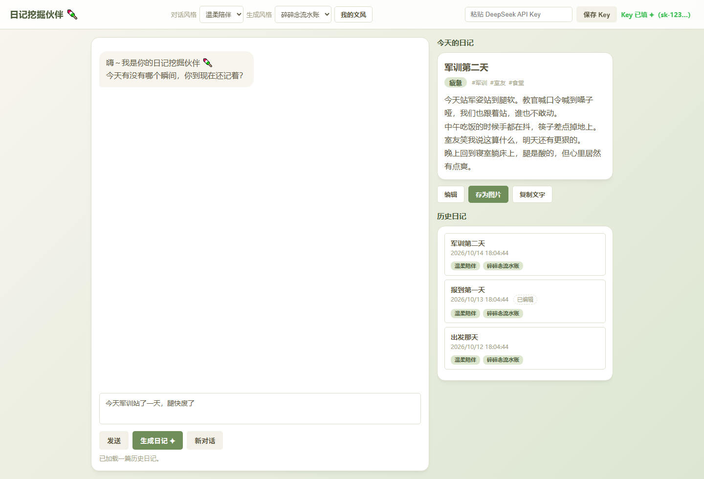
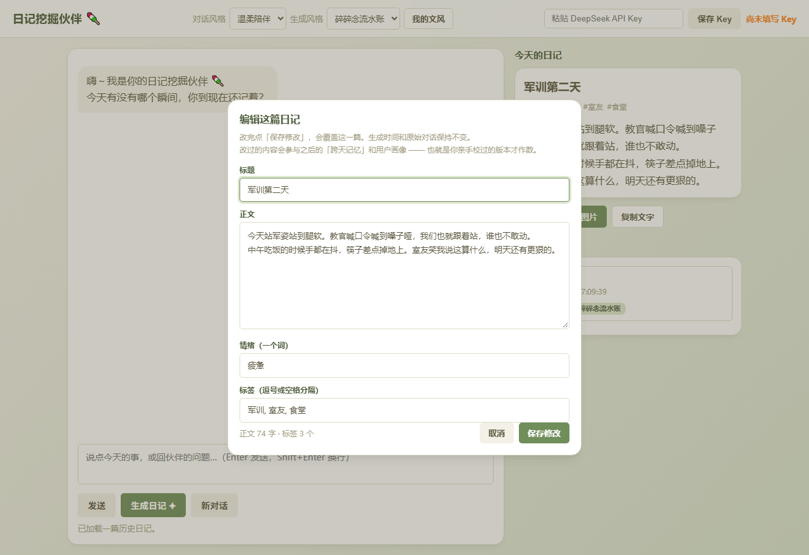

# 日记挖掘伙伴 🍡

> 一个**本地运行的日记小网页**：不逼你憋字，先像朋友一样跟你聊天，把你今天值得记的事一点点「挖」出来，再整理成一篇带情绪、带关键词的日记——还能一键导出成手账风图片分享。
>
> 为「物光创新实验室 2026 招新」自主设计并完成的作品。



左侧是对话与输入，右侧是「今天的日记」和「历史日记」。上图是填了几篇日记后的样子：日记卡片下方是编辑 / 存为图片 / 复制文字三个按钮，历史列表里「已编辑」是我手动改过的标记。

---

## 1. 我想解决的问题

很多人（包括我自己）卡在同一件事上：**知道写日记有好处，但坐下来发现「今天好像啥也没发生」，写不出第一句话。**

市面上的日记 app 基本都假设「你已经知道要写什么」，给你一个空白编辑框就结束。这个项目换了个方向：**把「想不起来」这一步交给对话。**

你不用组织语言，就用大白话跟伙伴闲聊——它负责追问（「后来呢」「当时什么感觉」），再把你说的东西整理成一篇第一人称的日记。**你负责回忆，它负责成文。**

应用场景很具体：**躺在床上、灯已经关了、不想开电脑也不想写字的时候，用手机/电脑说两句今天的事，就有一篇日记。**

## 2. 已实现的功能

### 🗣️ 对话挖掘（核心）
- AI 伙伴主动提问、共情，逐步把素材勾出来，而不是等你写
- 四种对话人设（温柔陪伴 / …）× 四种生成调性，可自由组合
- 聊完点「生成日记 ✦」，得到结构化日记

### ✍️ 风格控制（这块专门打磨过）
- **「我的文风」**：粘贴你自己以前写的日记当样本，生成时模仿你的语气
- **「按我的文风」纯模仿模式**：撤掉所有预设调性与内置范例，只按你的样本写
- **用户画像**：从过往日记里归纳稳定事实（身份 / 常出现的人 / 持续推进的事），注入到对话与生成里
- **跨天记忆**：注入当前日期 + 最近几篇日记摘要，能自然衔接前情（例如「军训第二天」得先写过第一天）

### 📤 产出与分享
- **结构化日记**：标题 / 正文 / 情绪 / 关键词
- **手动编辑**：AI 写得不对的地方，标题、正文、情绪、标签都能自己改，改完立刻同步到卡片、历史和导出；手改过的日记标一个「已编辑」
- **一键存为图片**：导出成手账风 PNG（2 倍高清），可直接分享
- **复制纯文字**：贴到任意地方
- **本地存储 + 历史回看**：数据只存在你自己的浏览器，不上传

### 🧪 工程质量
- **无头回归测试**：`node tests/run-all.js`，5 个测试文件、247 项断言，不需要浏览器、不需要 API Key
- **模型输出被截断时自动修补 JSON**，不会直接报错丢内容

<p align="center">
  
  
</p>

<p align="center"><em>左：一键导出的手账风图片（长标题换行、段落留间距、标点不落行首）。右：编辑弹窗，四个字段都可改。</em></p>

## 3. 三个我自己想清楚了的细节

功能列表看不出工作量，这三个点是我踩过坑之后重做的，也是我最想讲的：

### ① 让 AI「说人话」而不是「说 AI 话」
第一版生成的日记一眼假：句子对称、结尾必升华（「今天虽然累，但我明白了坚持的意义」）。这不是模型坏，是**我的提示词在引导它这么写**。

我的做法不是继续堆「不要写得像 AI」这种空话，而是：
- 禁掉具体句式（对称句、排比、升华句、抽象总结）
- 塞 **5 篇真人日记做 few-shot 范例**，让它有个具体的「人写的」参照
- 生成时把温度降到 0.4

### ② 中文排版的两件事（canvas 自己没有）
导出图片用的是 canvas 逐字换行，它不管中文排版规则。我自己补了两条：
- **段落之间要留出间距**——否则五段正文会糊成一整块
- **标点不能跑到行首**（避头尾）——句末标点悬挂在上一行行尾，开引号/括号回拉到下一行

并且给悬挂留了硬上限，保证**墨迹永远不会画出卡片内边距**（这条写成了测试断言，谁改常量都会被拦下来）。

### ③ 模型输出会被截断，这不是「模型乱写」
真机上报过一次 `Unterminated string in JSON`。查下来不是模型写错，是**输出在 316 字符处被切断**。做了四层防御：代理端完整读取响应 + 按断点位置分类修补 JSON + 提高 max_tokens 并读 `finish_reason` 告警 + 提示词里禁止在 JSON 字符串内出现英文双引号。

**诚实边界**：如果正文里出现了没转义的英文双引号，JSON 结构会直接坏掉，**补括号补不回来**——这种只能靠提示词规避，代码救不了。

## 4. 技术栈

- **纯前端**：HTML + CSS + 原生 JS。无框架、无构建、无依赖安装，`start.bat` 双击即跑
- **模型**：DeepSeek API（`deepseek-v4-flash`）
- **存储**：浏览器 localStorage（日记、画像、文风样本、API Key 全在本地）
- **CORS**：自带 `proxy.py` 本地代理（浏览器直连会被 CORS 拦）
- **设计系统**：本地内置 Open Props 变量文件（vendored，**不依赖 CDN**，断网也能正常显示）

## 5. 怎么跑起来

### 方式一（推荐）：一键启动
**双击 `start.bat`**。它会自动帮你：开本地代理 → 开网页服务器 → 打开浏览器。想停止，关掉弹出的两个黑窗口。

### 方式二：手动开两个终端
直接双击 `index.html` 不行（浏览器安全策略会拦），需要手动开两个终端。

```bash
# 终端①：启动本地代理（CORS 兜底，必开）
cd diary-app
python proxy.py          # 看到「本地代理已启动」就放着别关

# 终端②：启动网页服务器
cd diary-app
python -m http.server 8000
# 浏览器打开 http://localhost:8000
```

然后三步：
1. 去 DeepSeek 开放平台注册，拿一个 API Key
2. 在页面右上角「粘贴 DeepSeek API Key」框里填好，点「保存 Key」
3. 和伙伴聊天 → 聊得差不多点「生成日记 ✦」

> 提示 CORS / 网络失败的话，99% 是**忘了开 proxy.py**。

## 6. 文件结构（每个文件你都能单独读懂）

| 文件 | 作用 |
|------|------|
| `config.js` | 配置集中处（API 地址、模型名、存储键名、各种上限） |
| `store.js` | 日记本地存储（增 / 删 / 改 / 查） |
| `api.js` | 封装对 DeepSeek 的调用（Key 读取、截断诊断、错误处理） |
| `styles.js` | 所有风格预设与生成指令底座（想调语气只动这里） |
| `profile.js` | 用户画像：从过往日记归纳稳定事实 |
| `mystyle.js` | 「我的文风」：用户样本的保存与注入 |
| `exporter.js` | 导出：手账风图片的排版与绘制 + 纯文字复制 |
| `app.js` | 主逻辑：对话状态、生成日记、历史回看、编辑、导出接线 |
| `index.html` | 页面结构 |
| `style.css` | 样式（配色变量集中在开头的 `:root`，便于换肤） |
| `open-props.min.css` | 本地内置的设计变量库（离线可用，勿改成 CDN） |
| `proxy.py` | 本地代理（CORS 兜底） |
| `start.bat` | Windows 一键启动脚本 |
| `tests/` | 无头回归测试，`node tests/run-all.js` 一次跑完 |
| `docs/images/` | README 用到的截图 |
| `AGENTS.md` | 项目长期规则与协作约定（改代码前先读） |

## 7. 怎么验证它真的能跑

```bash
node tests/run-all.js
```

当前结果：**5 个测试文件、247 项断言全部通过**。

| 测试文件 | 断言数 | 覆盖什么 |
|---|---|---|
| `json-repair.test.js` | 22 | JSON 截断修补的 7 种断点位置 + 端到端「截断响应下仍能生成日记」 |
| `gen-prompt.test.js` | 37 | 两种提示词拼装路径的差异、纯模仿模式的保留项、三种拦截场景 |
| `exporter.test.js` | 75 | 图片排版纯逻辑：换行、段落间距、中文禁则、行坐标、极端输入 |
| `export-flow.test.js` | 39 | 用 canvas 桩把「真正画一遍」的路径走通（含下载触发） |
| `edit-diary.test.js` | 74 | 编辑语义、标签解析、编辑后导出的是新内容、「已编辑」不进数据 |

另外导出图片的视觉效果我用**无头 Chrome 渲染 + 读回图片**的方式自查过（见下文前后对比）。**但截图不等于真机**——字体、屏幕缩放、下载流程仍然要真机跑一遍，我没有把「测试全绿」当成「产品没问题」。

## 8. 工程方法论（对应 Agent 工程框架）

这个项目不是「想好一次写完」，而是按 **Goal / Context / Harness / Loop** 的思路持续迭代。用大白话对照：

| 框架概念 | 在本项目里的真实样子 |
|---|---|
| **Goal（目标 + 完成标准）** | 「做一个会聊天、把今天挖成日记的本地网页」。完成标准：真机跑通、日记读起来像人写的、没有 AI 套路话。 |
| **Context（可信上下文）** | 不靠猜。直接读项目文件、官方文档、真机报错截图，而不是凭印象判断问题在哪。 |
| **Harness（执行约束）** | 纯前端无框架；Key 只存浏览器；`.gitignore` 排除用户数据与缓存；`AGENTS.md` 写死改动边界和「已知失败模式」。 |
| **Explore / Plan** | 每个改动先想清楚再动手。例如「先做纯文字，识图放后面」「先用一个 Key 跑通全链路」。 |
| **Execute** | 按职责拆文件：`styles.js` 管提示词、`store.js` 管存储、`exporter.js` 管导出，一个文件只干一件事。 |
| **Observe / Verify** | 分三层看证据。**逻辑层** `node tests/run-all.js` 拿「247 PASS / 0 FAIL」；**视觉层**用本机 Chrome 无头渲染临时预览页、把截图读回来看；**感官层**仍需真机双击跑一遍——CORS、Python 环境、浏览器缓存只能在真机暴露。 |
| **Loop（闭环修正）** | 都是真实发生的事：① 浏览器直连被 CORS 拦 → 加 `proxy.py`；② 没装 Python 服务秒退 → 写 `start.bat`；③ 生成太「AI 味」→ 重写生成底座；④ 真机报 JSON 解析失败 → 查出根因是**输出被截断**（不是模型乱写），修了代理的响应完整性、写了 JSON 自动修补，顺带发现原实现只覆盖 5 种断点位置里的 1 种；⑤ 用户反馈「还是被原有风格影响」→ 排查出 **5 个风格渗入点**（含「对话历史」和「注入的旧日记」这两个隐藏源），据此做出纯模仿模式；⑥ 导出图**截图看一眼**才发现段落糊成一团、标点跑到行首；⑦ 加编辑功能时发现「保存成功后导出还是旧内容」——因为导出读的是另一个变量，用 canvas 桩断言「画布上画的是新正文」才锁住。 |
| **Learn / Verified Memory** | 验证过的经验沉淀进 README、`AGENTS.md` 和回归测试；没验证的只当假设。 |

**一句话**：这个项目是按「目标清楚 → 真机验证 → 闭环修正」的思路做的，每一轮改进都有真实运行或测试的证据，而不是堆功能。

## 19. 已知不足与边界

- **识图没做**。原本计划支持上传照片让 AI 写进日记，但这轮时间不够，也没有真正验证过，所以**代码里没有这个功能**，只在 `config.js` 里留了模型名便于以后切换。
- **文风模仿做不到「完全像你」**。给模型 3 段、每段 400 字的样本，它能学到句长、口头禅这类表面特征，学不到深层语感；模型本身也有自己的底噪。纯模仿模式是**减少干扰**，不等于换一支笔。
- **导出图像素级样式没在多种设备上验证过**。字体和屏幕缩放会影响观感。
- **没有后端、没有账号系统**。数据只在你自己的浏览器里，换设备就看不到——这是刻意的取舍（隐私优先、零部署成本），不是没做完。
- **英文长单词可能被从中间断开**。逐字换行对中文友好，英文没做断词，收益不大就留着了。

## 11. 隐私与开源说明

- API Key 只存在**你自己浏览器的 localStorage**，不在代码里，也不进仓库。
- 日记数据只在本地浏览器，不会上传；开源时不包含任何用户数据。
- 第三方资源：仅本地内置 Open Props（MIT）变量文件，保留原文件未改动。


